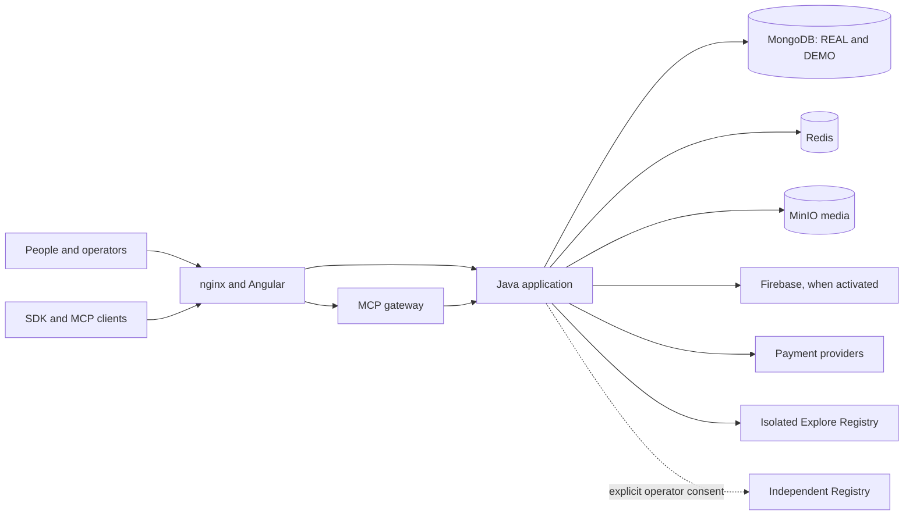

# MyScoutee architecture

This repository is a **MyScoutee engineering knowledge base**. It covers
software architecture, delivery methods, technology
experiments, marketing and cost decisions. The architecture section explains
the current product and its code/runtime boundaries; the methods section
compares sequential planning, RUP, agile methods and engineering practices,
then proposes a staged path from RUP toward agile delivery. Decision chapters
record options and evidence without presenting an unadopted idea as MyScoutee
policy.

The guide distinguishes the installed Compose product, source stacks and KVM
microservices lab. Their behavior and qualification differ; the owning source
repositories remain authoritative.

## Engineering topics

| Topic | Start here |
| --- | --- |
| Architecture deep dive | [Context and ownership](guides/development/architecture/01-context.md) |
| Methods and transformation | [Waterfall, RUP, agile methods and two transition stages](guides/development/methods/rup-to-agile.md) |
| Product and marketing | [Marketing metrics, channels and evidence](guides/development/decisions/marketing.md) |
| Cost and technology choices | [Netcup, cloud and Cloudflare comparison](guides/development/decisions/netcup-cloudflare-cloud.md), [AWS/Azure/Google/OCI billing comparison](guides/development/decisions/cloud-provider-stacks-and-billing.md), [cost decision lens](guides/development/decisions/cost.md) and [technology trials](guides/development/decisions/technology-trials.md) |

## Architecture deep dive

| View | Question answered |
| --- | --- |
| [Context and ownership](guides/development/architecture/01-context.md) | What does MyScoutee do, and which repository owns each capability? |
| [Application and data](guides/development/architecture/02-application-and-data.md) | How do requests, data, workers and cross-domain calls work? |
| [Deployment and operations](guides/development/architecture/03-deployment-and-operations.md) | What runs in each environment, and what are the recovery boundaries? |
| [Security and integrations](guides/development/architecture/04-security-and-integrations.md) | Where are trust boundaries, permissions, external services and labs? |
| [Evidence and decisions](guides/development/architecture/05-evidence-and-decisions.md) | What is verified, and what should be decided next? |
| [Architecture approaches applied](guides/development/architecture/06-frameworks-applied.md) | How would C4, arc42, TOGAF ADM and ADRs describe the same MyScoutee system and a possible change? |
| [Firebase configuration](guides/development/architecture/07-firebase-configuration.md) | What does Firebase provide and which settings control its activation? |

The [English engineering guide (PDF)](guides/publication/manuals/MyScoutee_Engineering_Deep_Dive_EN.pdf)
is built from the architecture, methods and decision chapters. Its
[source and build instructions](guides/publication/manuals/README.md) live
beside the artifact.

The separate patterns, data structures and algorithms learning PDF is published
under `myscoutee-backend/guides/learning/`. Its editable [technical inventory](guides/development/engineering/patterns-data-structures-and-algorithms.md)
and [laboratory map](guides/development/engineering/laboratory-map.md) remain here
beside the PDF generator.

## System at a glance

The diagram describes the **application model**. In the KVM laboratory the Java
application is assembled as eight domain services behind a gateway. The
separate Big Data, Elastic, 2FA, security and infrastructure labs are absent
from this runtime unless an integration is designed and implemented.

## Documentation method

The architecture chapters use a practical TOGAF-inspired progression: business
context, application and data architecture, technology/deployment architecture,
then evidence, risks and decisions. A separate [worked comparison](guides/development/architecture/06-frameworks-applied.md)
shows how C4, arc42, TOGAF ADM and ADRs would describe the current system or a
proposed change; none is claimed as an adopted MyScoutee standard. The methods chapter compares sequential
planning, RUP, two explicit transition stages, agile methods and coding
practices. No named framework is claimed as a current organizational mandate.
This repository does not replace
the source repositories' contracts, release notes, QA records or operator
manuals. Owners change canonical configuration first; this map follows it.
