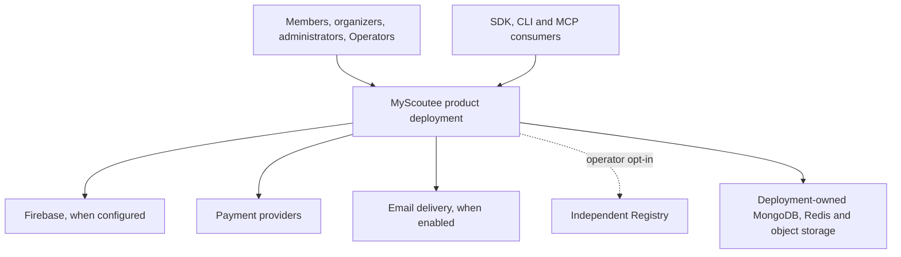

# 1. Context and ownership

**Status:** current-source architecture, with experimental boundaries called out explicitly. See the [source ledger](sources.md).

## Purpose and actors

MyScoutee organizes **Dating, Work and Community** activity around a completed, mutually welcomed real-world meeting. The product supports profiles, mutual priorities, events and groups, work campaigns and service offerings, community cases, announcements, voting, chat, calls, notifications and human ratings. API and MCP clients may perform permitted organizing tasks; personal decisions such as ratings and ballots remain in the human UI.

| Actor | Main interaction | Authority boundary |
| --- | --- | --- |
| Member or group profile | Explore, organize, participate and converse | Own session and profile/group permissions |
| Administrator | Moderation, configuration and scoped statistics | Administrator role, separate from Operator |
| Deployment Operator | Deployment configuration, updates and Registry enrollment | Authenticated Operator; host policy still limits Registry egress |
| External client | Profile-bound integration API or MCP | Claimed token/connection, pack and existing application permissions |
| Registry operator | Independent operator network and protocol | Separate deployment, identity and database |

## System context

These external connections are conditional. A bootstrap Operator login exists independently of Firebase; Firebase activation follows staging and checks. A payment simulator and Explore Registry serve demo/test paths. Neither represents a production payment provider or the Operator-selected Registry.

## Canonical owners

| Repository | Responsibility |
| --- | --- |
| [Backend](https://github.com/fssrepository/myscoutee-backend) | Product Java domains, composition inputs, packaging selections, QA and release evidence |
| [Frontend](https://github.com/fssrepository/myscoutee-frontend) | Angular UI, HTTP/local adapters and user workflows; recorded as backend submodule |
| [Base](https://github.com/fssrepository/myscoutee-base) | Published shared Java business libraries and BOM for backend and template |
| [Components](https://github.com/fssrepository/myscoutee-components) | Shared UI and technical components |
| [Microservices](https://github.com/fssrepository/myscoutee-microservices) | Reusable assembly, KVM/K3s, Helm, transport and monitoring mechanisms |
| [Registry](https://github.com/fssrepository/myscoutee-registry) | Independent Go Registry server, protocol and SQLite persistence |
| [nginx](https://github.com/fssrepository/myscoutee-nginx), [MCP](https://github.com/fssrepository/myscoutee-mcp) | Shared edge and MCP implementations consumed as versioned images |
| [Packaging](https://github.com/fssrepository/myscoutee-packaging) | Shared installer, update and recovery tooling |
| [Template](https://github.com/fssrepository/myscoutee-template) | Separate application using shared dependencies, with its own product and deployment configuration |

The architecture repository is a **derived map**. It must not become a second owner of API schemas, business code, secrets, image locks or deployment configuration.

## Architectural principles visible in the source

1. Product domain implementations have one backend owner. The eight-service lab selects those same source units rather than duplicating them. Cross-service calls use API/DTO contracts and explicit transport bindings.
2. The source/packaged Compose application and KVM microservices lab are different runtime forms. A build does not establish distributed runtime qualification.
3. The Registry is optional and independent. Its identity and receipt boundary is not the product data store.
4. Release notes, QA records and KVM checks are separate evidence sets; a lab feature is not automatically a product feature.
