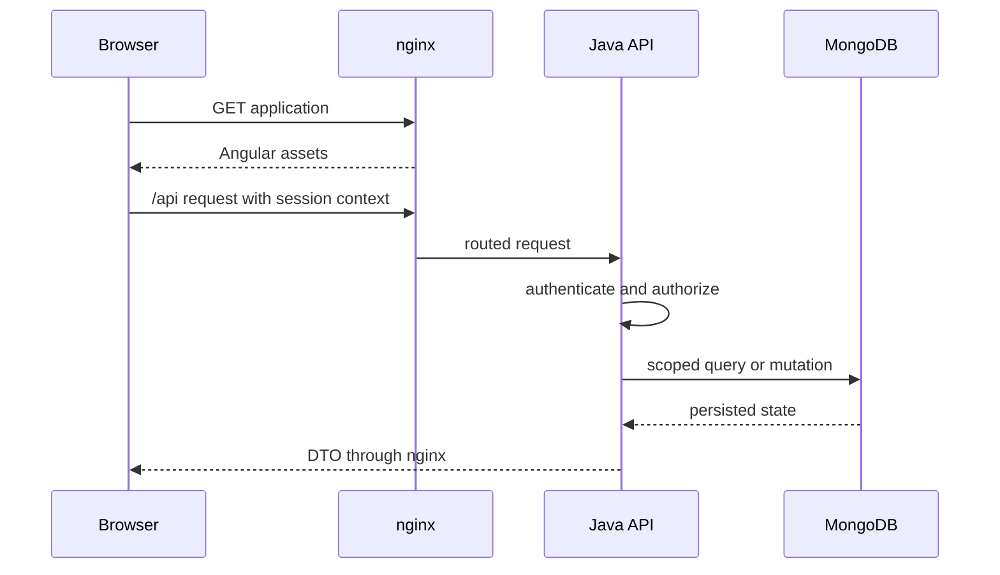
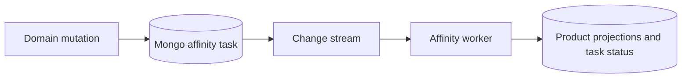

# 2. Application and data architecture

**Status:** current source and configured runtime paths. The monolith and distributed lab are distinct deployment views. See [source ledger](sources.md).

## Request and adapter path

Angular selects `local` or `http` adapters through environment and route configuration. Development, E2E and production select HTTP with `/api`; default/GitHub examples select local. The local path uses browser-side sources, seed builders and IndexedDB and cannot prove server behavior. In HTTP mode nginx serves the frontend and routes API/MCP traffic to the Java application and MCP gateway. Angular initialization loads translations and session state; its HTTP chain handles connectivity, session mode, authentication and payment-provider synchronization.

Exact endpoints, session headers and write preconditions belong to owner contracts and API guides. The diagram shows a representative path, not every route.

## REST and SOAP at the API boundary

REST is an architectural style that organizes HTTP APIs around resources and methods such as `GET` and `POST`; JSON is a common payload format. SOAP is an operation-oriented messaging protocol that wraps XML messages in a SOAP envelope, commonly with a WSDL contract. SOAP can use HTTP, but that alone does not make it REST.

MyScoutee's browser and external integration paths use HTTP endpoints with JSON payloads (and multipart uploads where needed). Its split-service calls use typed HTTP/JSON contracts described by OpenAPI; live chat uses WebSocket. The inspected product baseline has no SOAP endpoint or WSDL. Connecting a SOAP-only partner would require an explicit adapter that preserves MyScoutee's existing authorization and data boundaries.

## Java source and assembly

The product backend has one Java application project. Its domains cover accounts, access, administration, affinity, assets, campaigns, chat, community, content, email, events, feedback, groups, help, integrations, localization, media, notifications, operator functions, payments, platform functions and registry integration. Shared code covers configuration, security, delivery and Mongo support. The KVM lab assembles this same source into eight services; it is another deployment form, not a second product implementation.

| KVM assembly | Domain groups selected from the same Java source |
| --- | --- |
| `identity` | accounts, access, administration, platform, integrations |
| `community` | groups, community, events, campaigns, content, feedback |
| `communication` | chat, notifications, email, localization |
| `assets` | assets, media |
| `payments` | payments |
| `affinity` | affinity |
| `help` | help |
| `network` | operator, registry |

Assembly configuration defines the eight groups and their budgets. Explicit transport bindings define implemented cross-service contracts; the gateway maps public routes and keeps internal and repository routes private. The lab retains REAL and DEMO databases in one Mongo replica set. The split does not create eight independently owned data products.

## Persistence boundaries

| Store | Current role | Critical limit |
| --- | --- | --- |
| MongoDB | Product documents, configuration, jobs, outboxes, REAL/DEMO databases | Source Compose defaults to a **single-member** replica set for change streams; it does not provide database failover |
| Redis | Cache and coordination used by selected domains | Not canonical business record |
| MinIO/object store | Media object bytes | Object and Mongo metadata require coherent recovery |
| Browser IndexedDB | Local adapter and selected browser caches/outboxes | Does not prove server persistence or authorization |
| Registry SQLite | Independent Registry protocol state | Explore Registry state must not mix with an external Registry |

DEMO data is disposable. The single-member Mongo replica set enables change streams and retains the official initialization path.

## Why MongoDB?

Profiles, groups and events in MyScoutee contain optional sections and lists that vary between records. MongoDB stores each record with its own details in a document, making that record the unit of an atomic write. A normalized relational design would spread those details across related tables and require coordinated row changes for the same update. This is why the product uses MongoDB for its data; it has no parallel relational store.

## Example: affinity recomputation

A profile, event, asset or configuration change enqueues a durable affinity task with a key, target, status and availability time. The worker claims due work and calculates projections from product data. Normal Compose configuration uses Mongo change streams to wake the worker in REAL and DEMO; reconnect scans pending work and timers handle future deadlines. Fallback polling is normally disabled.

The Big Data lab's Kafka/Flink affinity messages are synthetic; they do not replace this task store, scoring inputs, retries or authorization. Notifications, email and Registry reporting also have durable outbox/worker paths in Java. Their exact delivery contracts remain with their source and tests.
