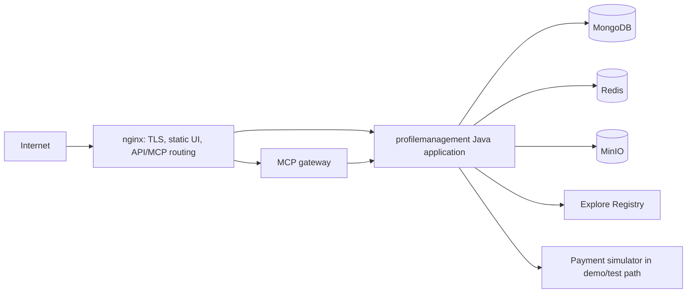

# 3. Deployment and operations

**Status:** configuration-based comparison. A source stack, an installed release and a KVM lab have different qualification scopes. See [source ledger](sources.md).

## Runtime forms

| Form | Runtime | Purpose and evidence limit |
| --- | --- | --- |
| Backend source development | Development Compose over shared base/replica configuration | HTTP app, frontend sync, local Registry/MCP and simulators; no automatic restart |
| Backend source E2E | Isolated Compose test stack | Separate test project and fixtures; no automatic restart |
| Backend source production | Source production Compose model | Production images and `unless-stopped` policy |
| Installed application | Versioned Debian package and Compose runtime | Installed product on Netcup; qualified separately from source stacks and the KVM lab |
| KVM microservices lab | Eight Java assemblies on K3s/Helm | Lab monitoring; not the installed Compose product |

The source Compose models select their own Registry/MCP image variants and separate their demo data/key state. Their legacy published ports and fixed service names mean dev/E2E/prod stacks are **not generally concurrent on one Docker host**.

## Container topology

The independent external Registry and real payment providers sit outside this deployment. The source production and packaged models each have their own concrete image and volume selections. This diagram is logical; inspect the Compose file for exact ports, mounts, TLS files and health checks before operation.

## KVM split path

The product has eight service groups in the KVM lab. Its shared runtime builds images from canonical product source and resolved dependency inputs, reuses unchanged image identities, renders Helm assets and manages the KVM/K3s deployment. Product runtime configuration sets the namespace, database names, dependencies, frontend and metrics NodePorts, and monitoring project. The gateway routes by explicit public path while internal APIs stay private. Mongo uses a replica set in the lab.

The lab's `mongo-seed` image volume holds initialization scripts and canonical REAL/DEMO seed inputs; data persists on separate PVCs. A changed seed artifact does not reinitialize an existing Mongo volume. Lab Prometheus/Grafana monitoring is distinct from the standalone Elastic lab.

## State, failure and recovery boundaries

| Boundary | Consequence |
| --- | --- |
| Single-member Compose Mongo | Change streams work, but node loss interrupts writes; no automatic Mongo failover |
| Mongo plus MinIO | Domain metadata and object bytes can diverge after partial restore |
| Registry deployment identity | Private key, state and receipts must remain coherent; loss is not a silent re-enrollment |
| Explore Registry | Isolated demo SQLite/key/Java-client state; never a recovery source for external Registry |
| Firebase activation | Staged configuration requires authentication and notification checks before activation |
| Installer/upgrade | Versioned image and migration inputs require the packaging owner's qualification workflow |

This guide does not issue backup or restore commands. The current operator/packaging manuals own them. An architecture diagram cannot establish recovery point, recovery time or successful host restoration without a matched restore test.

## Observability and verification

The backend has runtime health, QA records and release evidence. The KVM lab exposes metrics through a restricted guest-only gateway listener and configured Prometheus/Grafana. The separate Elastic repository is a **local source-search/observability lab**, not the product telemetry plane. Any future production observability decision must specify sources, redaction, retention, access, costs and alert ownership, then verify the path end to end.
