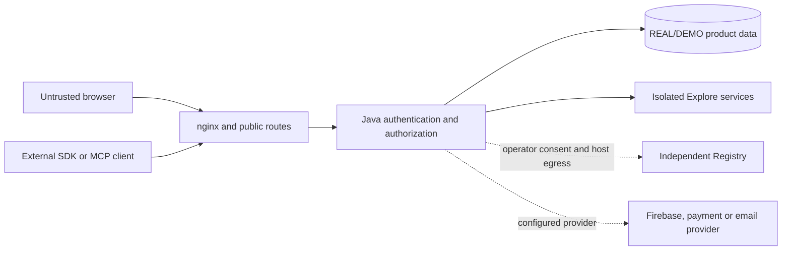

# 4. Security and integrations

**Status:** inspected source boundaries, not a penetration-test result or security certification. See [source ledger](sources.md).

## Trust boundaries

Java authentication distinguishes sessions, integration tokens and admin clients. Route policy scopes integration, Operator and media access; method and domain checks enforce the permissions for individual actions. A route's presence in public configuration is not proof that its mutation is public.

## Identity and API permissions

- Operator and Administrator are distinct authorities. A package can create a deployment-local bootstrap Operator credential on first installation. Firebase settings are staged and activated only after checks; Firebase does not automatically revoke the bootstrap login.
- Each integration token represents one external client slot, is claimed by a client identity and can be revoked. API packs limit operations but cannot grant a role the profile lacks.
- Anonymous `/mcp` help and authenticated `/mcp/private` personal operations are separate surfaces. Personal decisions, including ratings and ballots, are not integration writes. A client's advertised operation set is contextual and can change.
- DEMO and REAL have separate Mongo contexts. Demo accounts and isolated service data are not a substitute for checking production roles, persistence or outbound controls.

## Registry boundary

The Registry is an independent Go/SQLite deployment that accepts compatible applications without owning their product data. The backend is the only Registry network client in its deployment. A production installation starts uninitialized; the Operator chooses an endpoint, reviews its signed public identity, then confirms enrollment. Host-level `REGISTRY_OUTBOUND_ALLOWED` still gates egress. The deployment identity is Ed25519, with durable state and receipts; private-key loss after enrollment is an explicit recovery problem. The internal Explore Registry uses separate keys, data and client state.

## Adjacent repositories are experiments, not connected product services

| Repository | Verified local capability | Product boundary |
| --- | --- | --- |
| Big Data | Synthetic Kafka stream, ClickHouse queries, Spark/Parquet lake, Flink affinity rollups | Does not read current product Mongo/Redis or change product statistics |
| Elastic | CodeForge source search, findings and Elastic telemetry; optional Fleet lab | Local evaluation, not the production search/SIEM or MyScoutee telemetry plane |
| 2FA | Standalone Go TOTP/HOTP, WebAuthn and recovery-code API; optional Keycloak lab | No MyScoutee login integration in that repository |
| Security | Isolated source/image/passive-web scans | Reports require review; no application mutation or certification |
| Infra | Disposable Ansible/Puppet comparison on a synthetic nginx health page | Does not provision the backend or production edge |

A future integration requires an explicit product owner, threat/data-flow analysis, schema and auth contract, retention and operations design, a rollback route and matched runtime evidence. This is a decision checklist, not authorization to connect the labs now.
