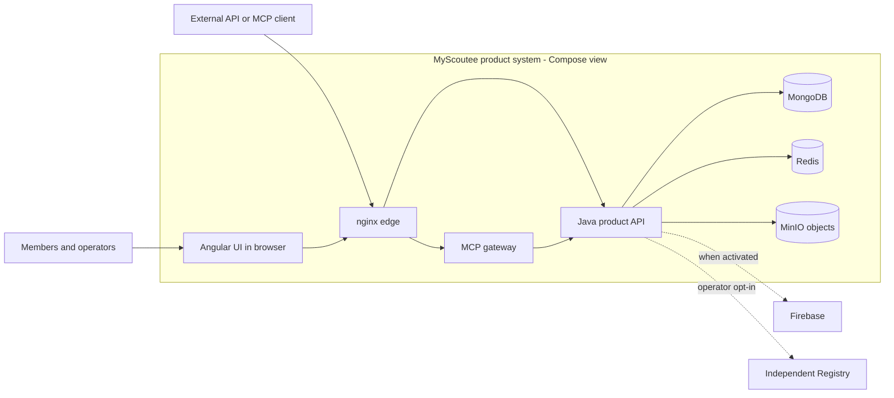

# 6. Architecture approaches applied to MyScoutee

**Status:** illustrative views of the inspected MyScoutee baseline, not a claim that the organization adopted TOGAF, C4 or arc42. A proposed change is labeled separately from current source or release evidence. The [shared discussion](https://chatgpt.com/share/6ae0e500-dbe0-83eb-b63e-d1932733ffeb) raised TOGAF ADM, C4, arc42 and Architecture Decision Records (ADRs); they answer different questions and can be used together.

No separate architecture application is required to use these examples. This Markdown file contains the editable comparison and Mermaid diagram; the repository generator renders the comparison and a matching diagram in the English PDF. C4, arc42, TOGAF ADM and ADRs name a diagram model, a documentation template, an architecture method and a decision-record format, respectively.

## Four approaches, one system

| Approach | What it organizes | MyScoutee example | What it cannot prove |
| --- | --- | --- | --- |
| C4 model | Diagrams that zoom from people and systems to containers, components and optional code | Show the product boundary, Angular/nginx/Java/MCP/data-store containers, then the affinity task path inside Java | A diagram does not establish that a deployment or recovery path passed qualification |
| arc42 | A tailored architecture document with goals, constraints, structure, runtime, deployment, decisions and risks | Put the existing context, data, security, deployment and evidence chapters under a common reading structure | A filled template is not implementation evidence |
| TOGAF ADM | An iterative enterprise architecture method connecting business intent, application/data/technology baselines, options, migration and governance | Evaluate whether the Compose product should ever promote a KVM split, with cost, ownership, data and rollback gates | A TOGAF phase name does not turn a lab into an adopted target architecture |
| ADR | A short record of one architecturally significant decision and its trade-offs | Record the chosen runtime form, alternatives, consequences and evidence when an owner actually decides | A proposed ADR does not authorize or implement its option |

Sources: [C4 diagrams](https://c4model.com/diagrams), [arc42 overview](https://arc42.org/overview/), [The Open Group's TOGAF overview](https://www.opengroup.org/togaf) and [ADR templates](https://adr.github.io/adr-templates/). These approaches are complementary, not competing deployment technologies.

## C4: zoom into the installed Compose product

This is a **C4-style container view**, not a new runtime design. A C4 container is an application or data store with a runtime responsibility; it is not necessarily a Docker container. The Angular application runs in the browser and is served by nginx. The diagram omits optional payment/email connections and the separate KVM lab to keep one deployment form legible. See [context](01-context.md), [application/data](02-application-and-data.md) and [deployment](03-deployment-and-operations.md) for source-backed detail.

| C4 zoom | What the MyScoutee view would contain | Evidence boundary |
| --- | --- | --- |
| 1. System context | Members, Operators, external clients, optional providers and the independent Registry around MyScoutee | The [context chapter](01-context.md) already provides this view |
| 2. Containers | Angular UI, nginx, Java API, MCP gateway, MongoDB, Redis and object storage | The diagram above describes the installed Compose model logically; exact images, ports and volumes belong to packaging |
| 3. Components | Within Java's affinity area: task service, durable task store, change-stream wake-up, worker and projections | The [affinity path](02-application-and-data.md#example-affinity-recomputation) is a focused candidate component view, not a claim that every Java package is a separate service |
| 4. Code | A task/worker class or interface diagram only when a specific implementation decision needs it | Generate from current source rather than maintaining a manual class catalog |

C4 also has deployment and dynamic diagrams. Here the [runtime forms](03-deployment-and-operations.md#runtime-forms) would be **separate deployment views** for source Compose, installed Compose and KVM/K3s; merging them would imply a runtime that does not exist. [C4's diagram guidance](https://c4model.com/diagrams) recommends using only the levels that add value.

## arc42: where the same evidence would live

The [arc42 template](https://arc42.org/overview/) has 12 tailorable sections. This repository already holds much of their content, but does not claim full arc42 conformance. A compact MyScoutee reading map would be:

| arc42 sections | MyScoutee content | Current source in this repo |
| --- | --- | --- |
| 1-4: goals, constraints, context, strategy | Real-world meeting outcome; source ownership; independent Registry; one Java domain source with alternate assemblies | [Context and ownership](01-context.md) |
| 5-7: building blocks, runtime, deployment | Java domain groups; request and affinity paths; installed Compose versus KVM lab | [Application/data](02-application-and-data.md), [deployment](03-deployment-and-operations.md) |
| 8-9: crosscutting concepts, decisions | Permissions, REAL/DEMO isolation, external-provider activation; accepted ADRs when they exist | [Security/integrations](04-security-and-integrations.md), [evidence/decisions](05-evidence-and-decisions.md) |
| 10-12: quality, risks, glossary | Recovery and privacy scenarios, unverified failover or integration claims, terms such as Operator and Registry | [Deployment/recovery](03-deployment-and-operations.md#state-failure-and-recovery-boundaries), [source ledger](sources.md) |

For example, an arc42 quality scenario would say: "After loss of the application host, restore Mongo documents, media objects and Registry identity from a coherent backup, then verify an authenticated product path and a Registry receipt." Its recovery-time target and acceptance result remain **unset** until an owner supplies and tests them. This turns a vague "reliable" claim into a reviewable question without inventing an SLA.

## TOGAF ADM: what a scoped change would ask

TOGAF's Architecture Development Method is iterative, with requirements managed across phases. Apply it here to a **hypothetical** question: should MyScoutee promote the KVM split beyond its lab? The current baseline is the published Compose product plus a distinct KVM lab; the target is undecided. The table is a small-scope example, not a mandate to run a full enterprise program.

| ADM work | MyScoutee question and possible output | Gate before claiming a target |
| --- | --- | --- |
| Preliminary and A: scope/vision | Who owns product, runtime and release decisions? Why consider a split: capacity, isolation or operating cost? | Named sponsor, constraints and measurable benefit |
| B: business architecture | Which member and Operator journeys must remain intact? What support and on-call burden is acceptable? | Product outcome and responsibility map |
| C: application/data | Which Java domain contracts move between processes, and who owns REAL/DEMO state, outboxes and Mongo writes? | API/data ownership and compatibility evidence |
| D: technology | Compare Netcup Compose, KVM/K3s and any cloud option on capacity, observability, recovery and invoice drivers | Verified runtime topology and cost assumptions |
| E/F: options/migration | Keep Compose, promote selected assemblies, or defer; sequence data migration, rollback and dual-form testing | Chosen option, migration plan and explicit stop rule |
| G/H: governance/change | Check release qualification, restore proof and drift after deployment; revisit when evidence changes | Accepted release evidence and an owner for architecture updates |

[The Open Group's ADM phase descriptions](https://www.opengroup.org/soa/source-book/togaf/p4.htm) support this mapping. Existing [cost](../decisions/cost.md), [cloud](../decisions/cloud-provider-stacks-and-billing.md) and [evidence](05-evidence-and-decisions.md) chapters supply inputs, not a completed Phase E/F decision.

## ADR: one decision, when it is actually made

For the same KVM question, a **proposed** ADR would record: **Context** - the Compose release and KVM lab have distinct qualification; **Options** - retain Compose, promote selected assemblies, or defer; **Decision** - pending the named owner and evidence; **Consequences** - deployment, cost, data and rollback responsibilities for the selected option; **Confirmation** - source changes plus QA, release and restore checks. The accepted record should link the exact revisions and supersede earlier records explicitly. Until then, this is a decision prompt, not a deployment plan. The [ADR template reference](https://adr.github.io/adr-templates/) describes the short context/decision/consequences pattern.

The smallest useful combination here is a current C4 context/container map, the existing arc42-like chapter structure, and an ADR for each material accepted choice. TOGAF ADM becomes useful when a change crosses business, application/data and technology ownership and needs a migration decision. Keep every view tied to the [source ledger](sources.md) and label present, lab and proposed states separately.
