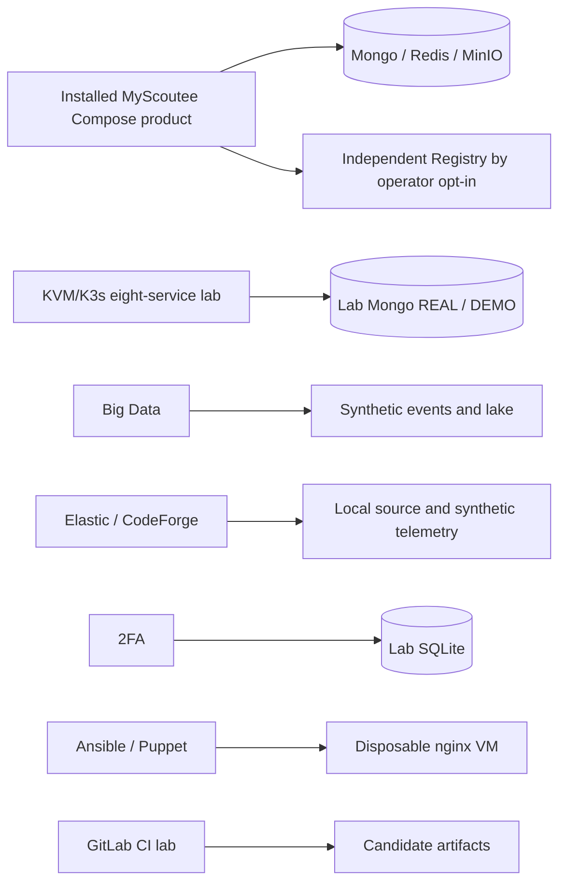

# Laboratory and supporting-system map

A laboratory capability is not automatically part of the installed product. The sections below show what each lab does and where its data stays.

## Runtime relationship

The installed product, backend source Compose forms and KVM lab have different deployment and qualification evidence. Big Data, Elastic, 2FA, security and infrastructure labs are standalone. CI and SonarQube analyze/build sources; they are engineering systems, not member-facing product services.

## Capability and data boundaries

| Owner | What runs or is evaluated | Input and state | Product relationship |
| --- | --- | --- | --- |
| Backend source Compose | Development, E2E and production source-stack models | REAL/DEMO Mongo, Redis, objects, local adapters/simulators by profile | Canonical product source, but source stacks are not the installed release |
| `myscoutee-microservices` | KVM/K3s, Helm, eight domain assemblies, gateway and monitoring | Same application Java source; lab Mongo replica set and PVCs | Separate deployment experiment; no automatic release qualification |
| `myscoutee-bigdata` | Kafka/KRaft, optional Avro Schema Registry, ClickHouse, Spark/Parquet/SeaweedFS, Flink | Synthetic event stream, analytical tables and local lake | Does not consume product Mongo/Redis or replace affinity worker |
| `myscoutee-elastic` | CodeForge source search, Elasticsearch/Kibana and Beats; separate optional Fleet | Read-only source mount, local index and synthetic MyScoutee telemetry | Local evaluation, not product search, SIEM or production telemetry |
| `myscoutee-2fa` | Go TOTP/HOTP, WebAuthn, recovery codes; optional Keycloak OIDC/SAML trial | Its own SQLite and encryption key | Standalone factor API; no current MyScoutee login connection |
| `myscoutee-security` | Source, image and passive web assessment workflows | Isolated scan artifacts | Findings need review; scans neither mutate product data nor certify it |
| `myscoutee-infra` | Vagrant VM with Ansible/Puppet comparison | Same synthetic nginx health page, disposable guest | Does not provision product or production nginx |
| `myscoutee-ci` | Local GitLab, runners, registry and manual release gates | Source checkouts, job outputs and retained candidates | Delivery laboratory; application packages/images still have their owners |
| `myscoutee-sonarqube` | One SonarQube/PostgreSQL instance and selected source analyses | Native test/coverage reports and scan snapshots | Quality evidence, not runtime traffic or a product store |

## Adjacent implementation and test owners

| Owner | Scope | Boundary |
| --- | --- | --- |
| `myscoutee-mcp` | Shared Go MCP HTTP/stdio adapter and live backend capability filtering | Application-owned `product.json` and `contract.json`; backend owns identity and actions |
| `myscoutee-payment-simulator` | Stripe/Barion-shaped delayed capture, signed callbacks, replay and SQLite audit | Development/QA only; no card data and absent from production topology |
| `myscoutee-registry` | Independent Go/SQLite network directory and signed protocol | External to product; opt-in enrollment and separate Explore instance |
| `myscoutee-nginx` | Reusable edge image/configuration | Application route map and deployment settings select public surfaces |
| `myscoutee-packaging` | Shared Debian/package mechanisms | Backend/template own product inputs, images, migrations and release qualification |
| `myscoutee-e2e` and `myscoutee-qa` | Installation-level and manual QA evidence | Results describe the tested build, fixtures and runtime |
| `myscoutee-agent` and `myscoutee-skills` | Advisory trust prototype and agent instructions | Engineering workflow tools, not product AI services |

The frontend and shared components/base repositories are application dependencies, not separate experiments. The template is another product built from shared foundations and retains its own behavior and deployment configuration. No adjacent repository should be shown as a live data-flow arrow unless its integration is present in the product configuration and verified end to end.
