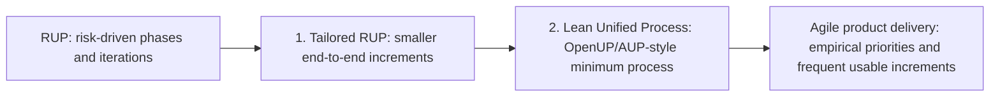

# Software delivery methods: from sequential plans to agile delivery

**Status:** general methodology reference and **proposed RUP-to-agile transformation model**, not a statement that MyScoutee currently uses any named framework. The approaches below overlap in time and solve different problems; the comparison is a map of practices and trade-offs, not a claim that one method historically replaced the next.

## What is being compared?

A **lifecycle model** says when requirements, design, implementation, testing and release receive attention. A **process framework** assigns work, roles, decisions and review points. A **team workflow** controls how work enters and leaves the team. **Engineering practices** keep changes safe, while **operations practices** make releases and recovery reliable. A team can, for example, plan an external release in stages, manage day-to-day work with Kanban, use XP testing/refactoring practices and keep RUP-style risk evidence. These are choices at different layers, not mutually exclusive badges.

## Waterfall-style planning: useful sequence, dangerous one-pass execution

The familiar waterfall picture places requirements, design, coding, testing and operations in a mostly sequential plan. It makes dependencies and external approval points visible, but a **single pass with testing near the end** exposes integration and performance surprises when change is expensive. The frequently cited [1970 Royce paper](https://www.praxisframework.org/files/royce1970.pdf) drew this sequence and then warned that its simple implementation was risky; it proposed feedback, early design/prototyping and customer involvement. Therefore, do not attribute a no-feedback waterfall prescription to Royce. Stage gates may still be needed for contracts, safety or release approval; verification should occur inside stages as well as at the gate.

## The important correction: RUP is already iterative

RUP has four phases - Inception, Elaboration, Construction and Transition - and each phase can contain iterations. IBM describes an iteration as a complete development loop producing an executable increment. The shift toward agile is therefore **not** simply “start iterating.” It is a shift in *how small and valuable increments are selected, who can change priorities, how often users see them, and how much governance is needed for a decision*. [IBM RUP best practices](https://public.dhe.ibm.com/software/rational/web/whitepapers/2003/rup_bestpractices.pdf), [IBM project planning](https://www.ibm.com/docs/en/rational-clearquest/10.0.8?topic=settings-project-planning).

The two stages below are a **recommended transition design**, not a claimed historical sequence or a formal standard. OpenUP and Agile Unified Process (AUP) are related lightweight Unified Process examples, not mandatory consecutive certifications. OpenUP is archived, so use its ideas as a reference rather than assuming active tool support. [Eclipse OpenUP overview](https://archive.eclipse.org/epf/downloads/OpenUP/published/openup_published_1.5.1.5_20121212/openup/publish.openup.base/customcategories/understanding_openup_A45D6188.html), [Eclipse project status](https://projects.eclipse.org/projects/technology.epf), [Scott Ambler on AUP](https://scottambler.com/the-enterprise-unified-process/).

## What RUP carried forward and what agile changed

This matrix compares the **same concerns** across approaches. The two middle transition stages are practical tailoring options described below. They are not named industry standards or a required route from RUP to Scrum.

| Concern | Sequential stage plan | RUP baseline | Stage 1: tailored RUP | Stage 2: lean Unified Process | Agile product delivery |
| --- | --- | --- | --- | --- | --- |
| Main control | Phase completion and approval | Phase objectives, risk and milestone evidence | Same phase intent, shorter demonstrable iterations | Minimum useful roles/artifacts and visible risks | Product goal, ordered value, inspection and adaptation |
| Work selection | Requirements baseline and change requests | Use cases and risks in iteration plan | Slice use cases into end-to-end outcomes | Small, revisable work list and visible risks | Ordered backlog or flow; select a near-term goal |
| Architecture | Design before most construction | Elaborate high risks before scaling construction | Prove one risky vertical slice | Just enough architecture for current risk | Continuous design; retain explicit system-risk decisions |
| Testing | Often concentrated late in a strict one-pass plan | Test within iterations and assess milestones | Tested executable slice each iteration | Frequent integration and checks | Tested usable increments; fast feedback |
| Review | Approval at stage boundaries | Milestone and iteration assessments | Demo/test each iteration | Frequent feedback and process adjustment | Review user outcomes and adapt priorities |
| Evidence | Phase deliverables and traceability | Tailored artifacts for risk and governance | Keep proof of risk, compliance and recovery | Fit-for-purpose work products | Keep evidence that changes decisions and supports safety |
| Release | Final transition after earlier stages | Transition phase organizes rollout | Release-capable output after slices where feasible | Explicit release planning | Release when ready; review is not a release gate |
| Decision rights | Often centralized change approval | Often formal project/phase governance | Clarify scope and quality/risk owners | Routine decisions closer to the team | Product and delivery accountabilities within guardrails |

The RUP column describes the process framework, not a judgment that all RUP teams create too much documentation. The agile column draws on the [Agile Manifesto and principles](https://agilealliance.org/agile101/12-principles-behind-the-agile-manifesto/) and uses [Scrum](https://scrumguides.org/scrum-guide.html) as one concrete example, not as the only agile method.

## Stage 1 - make RUP increments genuinely inspectable

Keep the four phase names and risk focus if they help stakeholders. Change the iteration contract: every iteration ends with a running, tested vertical slice and a stakeholder decision. Plan only the next small increment in detail. Track a short risk list with evidence that each risk is reduced or still open. Treat a milestone as a decision on *actual software and remaining risk*, not a document-completion percentage. IBM's own planning guidance expects executable, demonstrable and testable iteration outputs, so this stage is a stricter application and tailoring of RUP, not a replacement. [IBM planning paper](https://public.dhe.ibm.com/software/rational/web/whitepapers/2003/tp151.pdf).

**Exit signal:** stakeholders can inspect a small increment, see passed and failed checks, and reorder the next work without reopening a large phase plan. Keep safety, migration and release evidence when required.

## Stage 2 - make the Unified Process lean

OpenUP preserves Inception, Elaboration, Construction and Transition while emphasizing collaboration, early architecture/risk work and iterative increments. It is intentionally low ceremony and extensible. AUP was Scott Ambler's earlier simplification of RUP for software development. These are **alternative references** for removing work products that do not change decisions. Choose a minimal set: product vision, ordered work, architecture decisions, tested increments, deployment/recovery evidence and open risks. Avoid copying a full process library into every issue. [Eclipse lifecycle](https://archive.eclipse.org/epf/downloads/OpenUP/published/openup_published_1.5.1.5_20121212/openup/process.openup.base/deliveryprocesses/openup_lifecycle_EE511F3A.html_desc.html?path=_SuWj4dOPEdyqlogshP8l4g&proc=_SuWj4dOPEdyqlogshP8l4g), [Eclipse minimal process](https://archive.eclipse.org/epf/downloads/OpenUP/published/openup_published_1.5.1.5_20121212/openup/publish.openup.base/guidances/supportingmaterials/minimal_complete_extensible_6D757693.html), [Ambler's AUP context](https://scottambler.com/the-enterprise-unified-process/).

**Exit signal:** architecture and compliance evidence remains findable, while the team can change scope and improve its process without a separate process-change project.

## Agile product delivery - change the operating model

Adopt the Manifesto's preference for working software, customer collaboration and responding to change. In Scrum terms, an accountable Product Owner orders a Product Backlog, a cross-functional team creates a usable Increment in a Sprint, and stakeholders inspect and adapt. The Sprint Review is not a gate to releasing value. The Definition of Done makes quality explicit. The organization must also change funding, decision rights and feedback access; renamed meetings alone do not create agility. [Agile Manifesto](https://agilealliance.org/agile101/the-agile-manifesto/), [12 principles](https://agilealliance.org/agile101/12-principles-behind-the-agile-manifesto/), [Scrum Guide](https://scrumguides.org/scrum-guide.html).

**Exit signal:** priority changes are based on user/product evidence; teams can deliver a usable, verified increment frequently; risks and constraints are visible without waiting for a large phase boundary.

## Related methods operate at different layers

| Lens | Scrum | Kanban | Extreme Programming (XP) | DevOps / continuous delivery |
| --- | --- | --- | --- | --- |
| Primary question | What valuable increment will meet the next Sprint Goal? | How does work flow predictably from start to finish? | How can developers change code safely and frequently? | Can a verified change reach users and be recovered safely? |
| Control loop | Sprint, Review and Retrospective with a Product Goal and Definition of Done | Explicit workflow, WIP control and flow measures | Short releases, feedback, testing, refactoring and integration | Automated build/test/deployment, observability and recovery feedback |
| What it does not supply alone | A mandated coding or deployment practice | A product strategy or code-quality method | Organization-wide funding and governance | The right product goal or user demand |

[Scrum](https://scrumguides.org/scrum-guide.html) is a lightweight framework for complex work; [Kanban](https://kanbanguides.org/the-kanban-guide) specifies flow control and measures such as WIP, cycle time and throughput; [XP](https://agilealliance.org/glossary/xp/) is unusually explicit about engineering practices; [DORA's continuous-delivery guidance](https://dora.dev/capabilities/continuous-delivery/) focuses on keeping software deployable and making releases low risk. A team can combine compatible practices, but it must name who owns product priority, code quality, release authority and operational recovery.

## Where agile practice breaks

Agile's short feedback loop depends on real decisions and a working technical foundation. The failure is usually in those conditions, not in the mere presence or absence of a Sprint label.

| Missing condition | Observable failure | Required correction |
| --- | --- | --- |
| User access or empowered product decisions | Backlog items are completed without learning whether they helped anyone | Name a decision owner and inspect a user or operational outcome |
| Automated tests, integration and sustainable design | Each short cycle adds defects and makes the next cycle slower | Protect a usable Definition of Done; invest in tests, refactoring and CI |
| Architecture, security and recovery evidence | Local increments pass while cross-system risk accumulates | Keep risk-driven design, traceability and release/restore proof proportional to consequence |
| Realistic capacity and external dependencies | Sprint commitments become a fixed-scope contract despite interruptions | Make work and waiting visible; forecast from actual flow and keep release gates explicit |

Scrum itself calls the framework **incomplete** and requires transparency, inspection and adaptation; its Definition of Done cannot compensate for an absent test and release system. The [Agile Manifesto principles](https://agilemanifesto.org/principles) explicitly require technical excellence, sustainable pace and frequent working software. For delivery claims, measure both speed and stability, rather than velocity or ceremony counts alone; [DORA's metric history](https://dora.dev/insights/dora-metrics-history/) distinguishes throughput from instability. These sources support the conditions above; they do not prove that any particular MyScoutee team currently has these failures.

## Clean Code: an engineering discipline, not a new lifecycle

Robert C. Martin's [Clean Code](https://www.pearson.com/en-us/subject-catalog/p/clean-code-a-handbook-of-agile-software-craftsmanship/P200000009044?view=educator) (first edition 2008) organizes advice about naming, functions, error handling, tests and code review. Much of the underlying concern predates that label: [Parnas's 1972 modularity paper](https://doi.org/10.1145/361598.361623) addressed flexibility and comprehensibility, [Fowler's Refactoring](https://www.martinfowler.com/books/refactoring.html) first appeared in 1999, and XP included testing, simple design, refactoring and continuous integration. The book popularized and recombined practices; it did not create the need for maintainable code. Repeating a rule under a new name does not make a process better. Judge a coding rule by whether it improves comprehension and safe change in the actual codebase, with tests and system boundaries intact.

## Mapping the comparison to MyScoutee without inventing current policy

MyScoutee already has useful **artifacts** for such a transition: source-owned domain boundaries, a versioned QA matrix, release notes, product configuration, KVM qualification and an installer track. Those artifacts can support any chosen process. The repository inspection does **not** establish a Product Owner, Scrum team, sprint cadence or RUP phase governance. A real transformation decision should first record the current delivery cadence and decision rights, then choose a pilot product slice, its user feedback channel, quality gate and rollback evidence.

A useful pilot could select one small vertical change and measure: time from accepted idea to usable increment, time waiting for decisions, escaped defects, deployment recovery and whether the actual user goal was met. This is a **measurement proposal**, not a claim about current MyScoutee performance. Keep architecture, privacy, protocol and release evidence proportional to risk rather than dropping them to appear agile.

